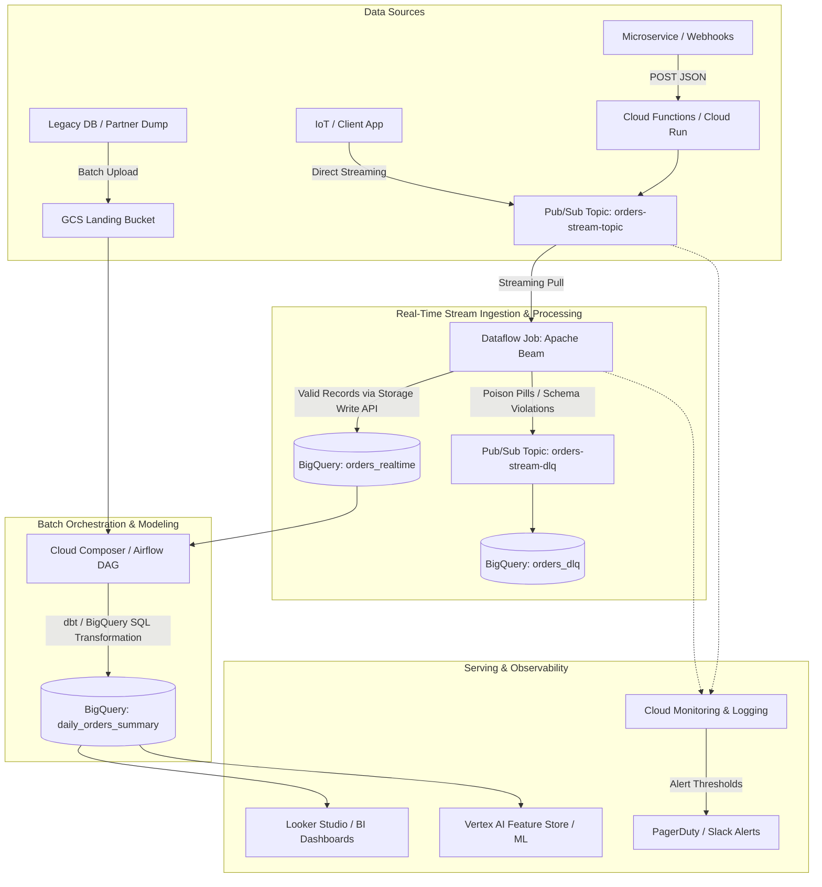

# GCP End-to-End Enterprise Data Platform & Pipeline

> 💡 **New to this repository or preparing for?** Start with the **[Plain-English Guide &  Preparation](docs/plain_english_guide_and__prep.md)** to understand what each folder and file does, followed by the **[Click-by-Click Console Guide](docs/gcp_end_to_end_pipeline__guide.md)**.

A production-ready reference implementation of a hybrid streaming + batch data platform on **Google Cloud Platform (GCP)**, designed for enterprise deployments and technical  preparation.

---

## 🏛️ Architecture Overview



---

## 📂 Repository Structure

```text
GCP/
├── README.md                               <-- Root project guide &  cheatsheet
├── terraform/                              <-- Infrastructure as Code (Terraform)
│   ├── main.tf                             <-- Core infrastructure declarations
│   ├── variables.tf                        <-- Configurable project variables
│   ├── outputs.tf                          <-- Generated resource endpoints
│   ├── terraform.tfvars.example            <-- Sample variable configuration
│   └── modules/
│       ├── bigquery/                       <-- Datasets, tables, partitioning
│       ├── pubsub/                         <-- Topics, subscriptions, dead-letter policies
│       ├── dataflow/                       <-- GCS buckets, Dataflow job launcher
│       └── iam/                            <-- Least-privilege Service Accounts & roles
├── pipelines/
│   ├── streaming_beam_dataflow/            <-- Real-time Apache Beam pipeline
│   │   ├── pipeline.py                     <-- Main Beam processing code with DLQ routing
│   │   ├── requirements.txt                <-- Python dependencies
│   │   ├── setup.py                        <-- Package definition for Dataflow workers
│   │   └── tests/
│   │       └── test_pipeline.py            <-- Unit tests using Beam TestPipeline
│   ├── batch_composer_airflow/             <-- Workflow DAGs for Cloud Composer
│   │   ├── dags/
│   │   │   └── ecommerce_daily_batch_dag.py<-- Daily aggregation Airflow DAG
│   │   └── sql/
│   │       └── aggregate_daily_orders.sql  <-- SQL transformation script
│   └── cloud_functions/                    <-- Serverless webhook ingestion
│       ├── main.py                         <-- Cloud Function entrypoint
│       └── requirements.txt
├── schemas/                                <-- Data contracts & schemas
│   ├── bigquery/
│   │   ├── orders_realtime.sql             <-- BigQuery DDL (Partitioned & Clustered)
│   │   └── orders_dlq.sql                  <-- Dead-letter table DDL
│   └── pubsub/
│       └── order_event_schema.json         <-- Expected JSON message contract
├── monitoring/                             <-- Observability & SRE definitions
│   └── alert_policies.json                 <-- Cloud Monitoring alert configurations
├── scripts/                                <-- Automation & testing utilities
│   ├── publish_test_events.py              <-- Load generator (publishes good records)
│   ├── simulate_poison_pill.py             <-- Error generator (tests DLQ routing)
│   └── deploy.sh                           <-- One-click deployment script
└── docs/
    ├── plain_english_guide_and_prep.md <-- 🟢 START HERE: Plain-English guide &  pitch
    ├── gcp_end_to_end_pipeline_guide.md <-- Complete Console & CLI click-by-click guide
    ├── deep_dive.md              <-- System design answers & trade-offs
    └── troubleshooting_playbook.md         <-- Debugging guide for production incidents
```

---

## 🚀 Quickstart: Running End-to-End

### 1. Set Up Infrastructure via Terraform
```bash
cd terraform
cp terraform.tfvars.example terraform.tfvars
# Update your GCP project ID in terraform.tfvars
terraform init
terraform plan
terraform apply -auto-approve
```

### 2. Launch the Streaming Dataflow Pipeline
```bash
cd ../pipelines/streaming_beam_dataflow
pip install -r requirements.txt

# Run locally with DirectRunner (Testing)
python pipeline.py \
    --project=<YOUR_PROJECT_ID> \
    --input_subscription=projects/<YOUR_PROJECT_ID>/subscriptions/orders-stream-sub \
    --output_table=<YOUR_PROJECT_ID>:ecommerce_analytics.orders_realtime \
    --dlq_topic=projects/<YOUR_PROJECT_ID>/topics/orders-stream-dlq \
    --temp_location=gs://<YOUR_PROJECT_ID>-staging/temp \
    --runner=DirectRunner

# Or deploy to Google Cloud Dataflow:
python pipeline.py \
    --project=<YOUR_PROJECT_ID> \
    --region=us-central1 \
    --input_subscription=projects/<YOUR_PROJECT_ID>/subscriptions/orders-stream-sub \
    --output_table=<YOUR_PROJECT_ID>:ecommerce_analytics.orders_realtime \
    --dlq_topic=projects/<YOUR_PROJECT_ID>/topics/orders-stream-dlq \
    --temp_location=gs://<YOUR_PROJECT_ID>-staging/temp \
    --staging_location=gs://<YOUR_PROJECT_ID>-staging/staging \
    --runner=DataflowRunner \
    --service_account_email=dataflow-worker-sa@<YOUR_PROJECT_ID>.iam.gserviceaccount.com
```

### 3. Generate Traffic & Verify
```bash
# Publish 50 valid order events:
python scripts/publish_test_events.py --project=<YOUR_PROJECT_ID> --count=50

# Inject 5 poison pills to test Dead-Letter Queue (DLQ):
python scripts/simulate_poison_pill.py --project=<YOUR_PROJECT_ID>
```
