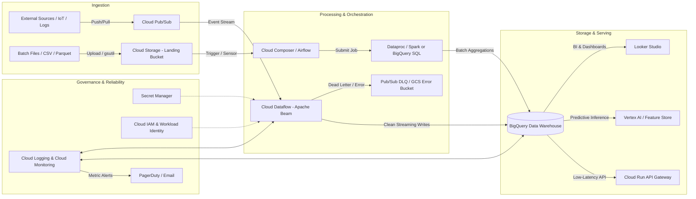

# End-to-End GCP Production Stack & Pipeline: Comprehensive Masterclass

This masterclass guide provides a complete blueprint for **Data Engineering, Cloud Architecture, and DevOps/SRE** on Google Cloud Platform (GCP). It covers architecture patterns, service selection matrices, step-by-step Console & CLI walkthroughs, common production failure modes, and interview trade-off answers.

---

## 1. The Reference Architecture: Real-Time & Batch Hybrid Pipeline

A production-grade GCP architecture frequently follows a **Streaming Ingestion + Batch Processing (Lambda/Kappa)** topology feeding a centralized data warehouse/lakehouse with automated monitoring, security, and alerting.



---

## 2. GCP Service Matrix: "What Does What, Where, and How to Use It"

| Service Category | GCP Service | Primary Purpose | Ideal Use Case | When NOT to Use (Gotchas) |
| :--- | :--- | :--- | :--- | :--- |
| **Ingestion** | **Cloud Pub/Sub** | Fully managed global real-time asynchronous messaging bus | Decoupling producers & consumers; event-driven ingest; IoT sensor streams | Point-to-point synchronous RPC (use Cloud Run/gRPC); ordered file archiving. |
| **Ingestion / Lake** | **Cloud Storage (GCS)** | Scalable object storage (Standard, Nearline, Coldline, Archive) | Raw file landing, Parquet/Avro data lakes, backups, staging data | Relational queries with ACID indexing; low-latency key-value lookups (<10ms). |
| **Stream / Batch Processing** | **Cloud Dataflow** | Serverless, autoscaling Apache Beam data processing engine | Exactly-once streaming pipelines, complex windowing, sessionization | Simple 1-step transformations (use BigQuery SQL or Cloud Functions); legacy non-Beam Spark jobs. |
| **Batch Big Data** | **Cloud Dataproc** | Managed Hadoop, Spark, Hive, and Presto clusters | Migrating existing on-prem Spark/Hadoop clusters, ML training on PySpark | Greenfield pipelines where serverless maintenance-free infrastructure is preferred. |
| **Orchestration** | **Cloud Composer** | Managed Apache Airflow workflow orchestration | Complex DAGs, multi-system dependencies (GCS -> Dataflow -> BQ -> Looker) | Sub-second event triggers (Composer/Airflow is for scheduled workflows; use Eventarc/Cloud Functions for real-time events). |
| **Lightweight Automation**| **Eventarc + Cloud Functions / Cloud Run** | Event-driven microservices / serverless compute | GCS file-arrival triggers, webhook receivers, lightweight validation | Heavy data transformations or batch jobs exceeding timeouts (max 60m for Run, 9m for Functions v1). |
| **Analytics Warehouse** | **BigQuery** | Serverless, petabyte-scale column-oriented SQL data warehouse | Ad-hoc analytics, OLAP dashboards, BigQuery ML, semi-structured JSON querying | OLTP transaction processing (row-level fast updates/inserts); sub-millisecond point queries. |
| **NoSQL Database** | **Cloud Bigtable** | Low-latency, high-throughput NoSQL wide-column store | Time-series data, high-QPS telemetry, fraud detection, AdTech serving | Complex SQL joins; data sizes < 1TB (Bigtable minimum cluster size is cost-inefficient for small data). |
| **Relational OLTP** | **Cloud Spanner / Cloud SQL** | Globally consistent ACID database (Spanner) / Managed MySQL/Postgres (Cloud SQL) | Core financial transactions, user accounts, transactional ledgers | OLAP analytical reporting or heavy aggregation queries over millions of rows. |
| **Security & Secrets** | **Secret Manager** | Centralized secret storage & rotation | API keys, database credentials, encryption certificates | Config files or non-sensitive runtime parameters (use environment variables or ConfigMaps). |

---

## 3. Step-by-Step Console Walkthrough: Building the Pipeline Click-by-Click

Here is the exact blueprint to deploy an end-to-end pipeline: **Pub/Sub $\to$ Dataflow $\to$ BigQuery** with a **Dead-Letter Queue (DLQ)** on Google Cloud.

### Step 1: Create the BigQuery Dataset & Target Table
1. Open Google Cloud Console: `https://console.cloud.google.com`.
2. Navigation Menu (top left $\equiv$) $\to$ **BigQuery** $\to$ **Studio**.
3. In the Explorer pane, click your project ID $\to$ click the **Three Dots ($\vdots$)** $\to$ select **Create dataset**:
   - **Dataset ID**: `ecommerce_analytics`
   - **Data location**: `US (multiple regions)` or `us-central1` (Keep all services in the exact same region to avoid egress fees and latency).
   - Click **Create dataset**.
4. In the SQL Editor tab, run the DDL query to create the table:
   ```sql
   CREATE OR REPLACE TABLE `ecommerce_analytics.orders_realtime` (
     order_id STRING OPTIONS(description="Unique UUID of order"),
     customer_id STRING,
     amount NUMERIC,
     items ARRAY<STRUCT<item_id STRING, qty INT64, price NUMERIC>>,
     order_timestamp TIMESTAMP,
     status STRING
   )
   PARTITION BY DATE(order_timestamp)
   CLUSTER BY customer_id, status;
   ```
   > **Tip**: Always mention **Partitioning** (by date) and **Clustering** (by high-cardinality query filter columns like `customer_id`) to demonstrate cost optimization and query speed awareness.

---

### Step 2: Create Pub/Sub Topics & Subscriptions (with DLQ)
1. Navigation Menu $\to$ **Pub/Sub** $\to$ **Topics**.
2. Click **Create Topic**:
   - **Topic ID**: `orders-stream-topic`
   - Check **Add a default subscription** (or uncheck to create custom ones).
   - Click **Create**.
3. Create the Dead-Letter Queue (DLQ) Topic:
   - Click **Create Topic** $\to$ **Topic ID**: `orders-stream-dlq` $\to$ Click **Create**.
4. Configure Dead-Lettering on the Main Subscription:
   - Go to **Subscriptions** tab $\to$ click **Create Subscription**.
   - **Subscription ID**: `orders-stream-sub`
   - **Cloud Pub/Sub Topic**: Select `projects/<YOUR-PROJECT>/topics/orders-stream-topic`.
   - **Delivery Type**: Pull.
   - Scroll down to **Dead lettering**:
     - Check **Enable dead lettering**.
     - **Dead-letter topic**: Select `orders-stream-dlq`.
     - **Max delivery attempts**: `5` (If a message fails 5 times, it drops into the DLQ).
   - Click **Create**.

---

### Step 3: Create the GCS Staging and Temporary Buckets
Dataflow requires temporary scratch buckets to stage code binaries and spill records.
1. Navigation Menu $\to$ **Cloud Storage** $\to$ **Buckets**.
2. Click **Create**:
   - **Bucket name**: `<your-project-id>-dataflow-staging` (globally unique).
   - **Location type**: Region $\to$ `us-central1`.
   - **Storage class**: Standard.
   - Access control: **Uniform** (Google best practice).
   - Click **Create**.
3. Inside this bucket, create two folders: `staging/` and `temp/`.

---

### Step 4: Launch the Streaming Cloud Dataflow Pipeline
1. Navigation Menu $\to$ **Dataflow** $\to$ **Jobs**.
2. Click **Create job from template**:
   - **Job name**: `pubsub-to-bigquery-orders`
   - **Regional endpoint**: `us-central1`
   - **Dataflow template**: Select **Pub/Sub to BigQuery** (or "Pub/Sub Subscription to BigQuery").
3. Set the Template Parameters:
   - **Cloud Pub/Sub input subscription**: `projects/<PROJECT_ID>/subscriptions/orders-stream-sub`
   - **BigQuery output table**: `<PROJECT_ID>:ecommerce_analytics.orders_realtime`
   - **Temporary location**: `gs://<PROJECT_ID>-dataflow-staging/temp`
4. Expand **Optional parameters**:
   - **Max workers**: `5` (Prevents runaway costs in demo/production).
   - **Service account email**: Use a custom dedicated service account (e.g., `dataflow-runner-sa@...`), NOT the default Compute Engine account.
5. Click **Run job**.
6. View the visual execution graph in the Dataflow console. Monitor step latency, system lag, and throughput.

---

### Step 5: Test the Pipeline End-to-End
1. Go back to **Pub/Sub** $\to$ **Topics** $\to$ `orders-stream-topic`.
2. Click the **Messages** tab $\to$ click **Publish Message**.
3. Enter valid JSON message body:
   ```json
   {
     "order_id": "ord-1001",
     "customer_id": "cust-55",
     "amount": 149.99,
     "items": [{"item_id": "prod-1", "qty": 2, "price": 74.99}],
     "order_timestamp": "2026-11-09T11:00:00Z",
     "status": "COMPLETED"
   }
   ```
4. Click **Publish**.
5. Switch to **BigQuery Studio**, open a tab, and query:
   ```sql
   SELECT * FROM `ecommerce_analytics.orders_realtime` WHERE order_id = 'ord-1001';
   ```
   Within 3–15 seconds, the record is visible in BigQuery!

---

## 4. Production-Ready Code & Automation via `gcloud`

Interviewers love candidates who know how to automate everything using Terraform or `gcloud` CLI instead of just clicking buttons:

```bash
# Set project and region
export PROJECT_ID="my-gcp-project"
export REGION="us-central1"
gcloud config set project $PROJECT_ID

# 1. Enable Required APIs
gcloud services enable \
    pubsub.googleapis.com \
    dataflow.googleapis.com \
    bigquery.googleapis.com \
    storage.googleapis.com \
    secretmanager.googleapis.com \
    monitoring.googleapis.com

# 2. Create Service Account with Least-Privilege IAM
gcloud iam service-accounts create dataflow-pipeline-sa \
    --display-name="Dataflow Pipeline SA"

# Grant roles: Dataflow Worker, BigQuery Data Editor, Pub/Sub Subscriber
gcloud projects add-iam-policy-binding $PROJECT_ID \
    --member="serviceAccount:dataflow-pipeline-sa@$PROJECT_ID.iam.gserviceaccount.com" \
    --role="roles/dataflow.worker"

gcloud projects add-iam-policy-binding $PROJECT_ID \
    --member="serviceAccount:dataflow-pipeline-sa@$PROJECT_ID.iam.gserviceaccount.com" \
    --role="roles/bigquery.dataEditor"

gcloud projects add-iam-policy-binding $PROJECT_ID \
    --member="serviceAccount:dataflow-pipeline-sa@$PROJECT_ID.iam.gserviceaccount.com" \
    --role="roles/pubsub.subscriber"

# 3. Create GCS Staging Bucket
gcloud storage buckets create gs://$PROJECT_ID-pipeline-staging \
    --location=$REGION \
    --uniform-bucket-level-access

# 4. Create PubSub Topics
gcloud pubsub topics create orders-stream-topic
gcloud pubsub topics create orders-stream-dlq

# 5. Run Dataflow Template
gcloud dataflow jobs run orders-pubsub-to-bq \
    --gcs-location gs://dataflow-templates-$REGION/latest/PubSub_Subscription_to_BigQuery \
    --region $REGION \
    --service-account-email dataflow-pipeline-sa@$PROJECT_ID.iam.gserviceaccount.com \
    --parameters \
inputSubscription=projects/$PROJECT_ID/subscriptions/orders-stream-sub,\
outputTableSpec=$PROJECT_ID:ecommerce_analytics.orders_realtime,\
outputDeadletterTable=$PROJECT_ID:ecommerce_analytics.orders_dlq
```

---

## 5. Comprehensive Error Handling & Troubleshooting Guide

questions frequently center around: *"What happens when service A can't talk to service B?"* or *"How do you diagnose a pipeline backlog?"*

### Failure Mode 1: IAM Permission Denied (`403 Forbidden`)
- **Symptoms**: Dataflow job fails at startup; Cloud Functions fail to write to Pub/Sub; Cloud Composer task logs output `Access Denied`.
- **Root Cause**: Missing role bindings on the runtime service account (not the user running the CLI!).
- **Resolution Strategy**:
  1. Inspect the service's runtime SA (e.g., `<project-number>-compute@developer.gserviceaccount.com` or custom SA).
  2. For GCS: Ensure `roles/storage.objectAdmin` or `roles/storage.objectViewer`.
  3. For BigQuery: The SA requires both `roles/bigquery.dataEditor` on the dataset **and** `roles/bigquery.jobUser` on the project level to execute ingest jobs.

---

### Failure Mode 2: Schema Drift & Bad Payloads (Poison Pills)
- **Symptoms**: Messages enter Pub/Sub, but BigQuery table row count stalls; Dataflow workers report JSON parse errors.
- **Root Cause**: Producer sent an invalid payload (e.g., missing mandatory field, string where integer expected, malformed JSON).
- **Architecture Solution**:
  1. **Pub/Sub Schemas**: Enforce an Apache Avro or Protocol Buffer schema on the Pub/Sub topic itself. Invalid messages get rejected synchronously at ingestion time before hitting the pipeline.
  2. **Dead-Letter Queue (DLQ)**: In Apache Beam/Dataflow, catch serialization exceptions and route failed elements to a side output (`DeadLetterSink`) writing to GCS or a separate DLQ BigQuery table for triage.

---

### Failure Mode 3: Dataflow Backlog & Autoscaling Bottlenecks
- **Symptoms**: Pub/Sub `oldest_unacked_message_age` spikes to minutes/hours; System Lag increases.
- **Root Cause**:
  1. Dataflow hit its `maxNumWorkers` limit.
  2. Worker CPU/Memory exhaustion (Out Of Memory / OOM crash loops).
  3. Quota limitations (Compute Engine vCPU quota in the selected region).
  4. Hot keys (grouping on a non-uniform key causing a single worker to choke on a massive key partition).
- **Resolution**:
  - Check Cloud Monitoring for Dataflow metric `dataflow.googleapis.com/job/system_lag`.
  - Increase machine type (`--workerMachineType n2-standard-4`).
  - Resolve hot keying by adding salting or windowing before `GroupByKey`.

---

### Failure Mode 4: BigQuery Quota & Streaming Insert Exhaustion
- **Symptoms**: HTTP `429 Too Many Requests` or BigQuery `quotaExceeded: Exceeded rate limits`.
- **Root Cause**: Traditional streaming inserts (`tabledata.insertAll`) have regional rate limits and cost implications.
- **Resolution**:
  - Migrate to the **BigQuery Storage Write API** (default in modern Dataflow and GCP connectors).
  - Storage Write API provides at-least-once or exactly-once delivery with high throughput, lower pricing, and dynamic multiplexing.

---

### Failure Mode 5: Private VPC & Network Isolation Failures
- **Symptoms**: Dataflow workers cannot download dependencies, talk to Cloud SQL, or resolve Pub/Sub endpoints.
- **Root Cause**: Dataflow workers run in private IP mode (`--disablePublicIps`) without a Cloud NAT or Private Google Access enabled.
- **Resolution**:
  1. Enable **Private Google Access** on the Subnet:
     ```bash
     gcloud compute networks subnets update <subnet-name> \
         --region=$REGION \
         --enable-private-ip-google-access
     ```
  2. Configure a **Cloud NAT** gateway on the Cloud Router so workers can pull external libraries without exposing public IPs.

---

## 6. High-Frequency GCP Scenarios & Winning Answers

### Q1: "When do you use Cloud Composer (Airflow) vs. Cloud Workflows vs. Cloud Dataflow?"
- **Answer Structure**:
  - **Cloud Composer**: Choose for long-running, scheduled batch workflows with multi-step, heterogeneous dependencies (e.g., extract from Salesforce $\to$ write to GCS $\to$ run dbt/BigQuery SQL $\to$ send Slack alert).
  - **Cloud Workflows**: Choose for lightweight, serverless, fast-starting API orchestrations (sub-second latency, microservice coordination, pay-per-step, no idle cluster costs).
  - **Cloud Dataflow**: Not an orchestrator! It is a **data processing execution engine** for transforming streams and massive batch files using Apache Beam. Composer often *orchestrates* the launching of a Dataflow job.

---

### Q2: "How do you choose between BigQuery, Cloud Bigtable, and Cloud Spanner?"
- **Answer Matrix**:
  - **Cloud Spanner**: Mission-critical OLTP applications needing global horizontal scale with strictly serializable ACID transactions (e.g., global bank ledger, inventory management).
  - **Cloud Bigtable**: Extremely high throughput (millions of ops/sec), sub-10ms latency for single-row key lookups (e.g., IoT metrics, real-time user profiles, recommendation store).
  - **BigQuery**: OLAP analytics, multi-terabyte aggregations, complex analytical joins across historical data, and BI reporting.

---

### Q3: "How do you ensure zero data loss during a streaming pipeline failure?"
- **Answer**:
  1. **Upstream Retention**: Keep Pub/Sub retention at 7 days. Even if Dataflow crashes or is stopped for upgrades, messages remain durable in Pub/Sub.
  2. **Storage Write API & Checkpoints**: Beam/Dataflow uses watermarking and checkpointing to guarantee **exactly-once processing semantics** into BigQuery.
  3. **Dead-Letter Routing**: Unparseable payloads are written to a secondary GCS bucket/Pub/Sub DLQ rather than dropped.
  4. **Snapshots**: Use Pub/Sub subscription snapshots to rewind the stream if downstream logic corrupts data.

---

### Q4: "How do you optimize BigQuery costs in an enterprise environment?"
- **Key Points to Hit**:
  1. **Partitioning & Clustering**: Reduces the bytes scanned by pruning partitions and blocks.
  2. **Avoid `SELECT *`**: BigQuery charges per byte read across columns; specify explicit columns.
  3. **Editions / Reservations vs. On-Demand**: Use Enterprise or Standard Editions with slot commitments and autoscaling baseline slots for predictable budgeting.
  4. **BigQuery BI Engine**: In-memory acceleration layer for Looker dashboards to eliminate repeated query execution costs.
  5. **Table Partition Expiration**: Automatically purge staging/raw tables after 30/90 days.
