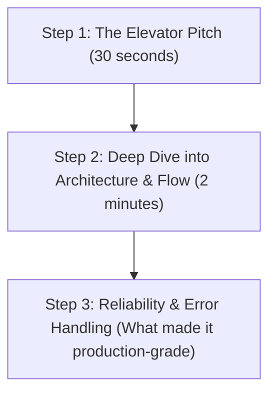

# Plain-English Guide to Your GCP Project Preparation

Don't let the directory structure intimidate you! Every folder here represents **one specific responsibility** in a real cloud team:

```text
GCP/
├── terraform/       👉 "The Blueprint" (Creates the cloud machines automatically)
├── schemas/         👉 "The Rules"     (Defines what valid data looks like)
├── pipelines/       👉 "The Engines"   (The actual code moving & transforming data)
├── scripts/         👉 "The Testers"   (Sends test data & triggers errors)
├── monitoring/      👉 "The Alarms"    (Alerts you when something breaks)
└── docs/            👉 "The Cheatsheet"(Your answers & study notes)
```

---

## Part 1: What Each Folder & File Does (File-by-File Breakdown)

---

### 1. 📂 `terraform/` — *The Infrastructure Blueprint*
In an enterprise, engineers never click buttons in the Google Cloud Console by hand. They write **Terraform** so everything can be created, updated, or deleted with one command.

* **[main.tf](file:///d:/Work/GCP/terraform/main.tf)**: The master file. It enables required Google Cloud APIs (Pub/Sub, Dataflow, BigQuery) and connects all the sub-modules together.
* **[variables.tf](file:///d:/Work/GCP/terraform/variables.tf)**: Defines parameters that can change between environments (e.g., `project_id`, `region`, `environment`).
* **[outputs.tf](file:///d:/Work/GCP/terraform/outputs.tf)**: Prints the newly generated resource names (like topic IDs and bucket names) after Terraform finishes.
* **[terraform.tfvars.example](file:///d:/Work/GCP/terraform/terraform.tfvars.example)**: A sample configuration file where you type your actual GCP Project ID.
* **📂 `modules/iam/main.tf`**: Creates a **custom Service Account** (`dataflow-pipeline-worker`) with *Least-Privilege* permissions.
  > **Why it matters**: Never run Dataflow using the default Compute Engine service account. Giving only `roles/dataflow.worker` and `roles/bigquery.dataEditor` is an enterprise security best practice.
* **📂 `modules/pubsub/main.tf`**: Creates the real-time messaging highway:
  * `orders-stream-topic`: The front door for incoming order events.
  * `orders-stream-dlq`: The **Dead-Letter Queue** where corrupted or bad messages are dumped.
* **📂 `modules/bigquery/main.tf`**: Creates the `ecommerce_analytics` dataset and tables with automatic date partitioning and clustering.
* **📂 `modules/storage/main.tf`**: Creates the Cloud Storage (GCS) buckets for temporary files, worker binaries, and raw data dumps.

---

### 2. 📂 `schemas/` — *The Data Contracts*
Before data enters a pipeline, both the producer and consumer must agree on what fields exist.

* **[order_event_schema.json](file:///d:/Work/GCP/schemas/pubsub/order_event_schema.json)**: The standard JSON contract for incoming orders (defines that `order_id`, `amount`, and `order_timestamp` are strictly required).
* **[orders_realtime.sql](file:///d:/Work/GCP/schemas/bigquery/orders_realtime.sql)**: The BigQuery table schema. Partitioned by `DATE(order_timestamp)` and clustered by `customer_id`.
* **[orders_dlq.sql](file:///d:/Work/GCP/schemas/bigquery/orders_dlq.sql)**: The BigQuery error table. Holds unparseable raw strings and the error stack trace so nothing is ever lost.

---

### 3. 📂 `pipelines/` — *The Processing Engines*
This folder contains the actual application code that processes data.

#### A. 📂 `streaming_beam_dataflow/` (Real-Time Pipeline)
* **[pipeline.py](file:///d:/Work/GCP/pipelines/streaming_beam_dataflow/pipeline.py)**: The core **Apache Beam** streaming code.
  1. Pulls events from Cloud Pub/Sub.
  2. Runs a validation step (`ParseAndValidateOrderFn`).
  3. If valid $\to$ writes to BigQuery using the **Storage Write API**.
  4. If invalid (poison pill) $\to$ routes to the **Dead-Letter Queue** (`orders-stream-dlq`) without crashing the job!
* **[setup.py](file:///d:/Work/GCP/pipelines/streaming_beam_dataflow/setup.py)** & **[requirements.txt](file:///d:/Work/GCP/pipelines/streaming_beam_dataflow/requirements.txt)**: Tells Google Cloud Dataflow workers which Python libraries to install on each VM.
* **[tests/test_pipeline.py](file:///d:/Work/GCP/pipelines/streaming_beam_dataflow/tests/test_pipeline.py)**: Unit test using `TestPipeline`. Proves that good records pass and bad records get routed to the DLQ.

#### B. 📂 `batch_composer_airflow/` (Daily Scheduled Batch)
* **[dags/ecommerce_daily_batch_dag.py](file:///d:/Work/GCP/pipelines/batch_composer_airflow/dags/ecommerce_daily_batch_dag.py)**: An **Apache Airflow / Cloud Composer** workflow that runs every morning at 2:00 AM UTC.
  1. Checks if raw landing files arrived in GCS (`GCSObjectExistenceSensor`).
  2. Runs an aggregation query to summarize revenue per customer.
  3. Runs an audit check to make sure no records have negative revenue.
* **[sql/aggregate_daily_orders.sql](file:///d:/Work/GCP/pipelines/batch_composer_airflow/sql/aggregate_daily_orders.sql)**: An idempotent SQL `MERGE` query that deduplicates late-arriving records.

#### C. 📂 `cloud_functions/` (Serverless Webhook)
* **[main.py](file:///d:/Work/GCP/pipelines/cloud_functions/main.py)**: A lightweight HTTP endpoint. When an external checkout service posts a JSON payload, this function validates it and forwards it into the Pub/Sub topic.

---

### 4. 📂 `scripts/` — *The Testing & Load Generators*
You don't need a live website to test this stack. These scripts simulate traffic:

* **[publish_test_events.py](file:///d:/Work/GCP/scripts/publish_test_events.py)**: Generates 50 realistic, valid order transactions and publishes them to Pub/Sub.
* **[simulate_poison_pill.py](file:///d:/Work/GCP/scripts/simulate_poison_pill.py)**: Deliberately sends corrupted strings, missing IDs, and wrong data types to Pub/Sub to prove your Dead-Letter Queue handles errors gracefully.
* **[deploy.sh](file:///d:/Work/GCP/scripts/deploy.sh)**: A one-click bash script that runs Terraform, runs the unit tests, and gives you the exact command to start Dataflow.

---

### 5. 📂 `monitoring/` — *Production Observability*
* **[alert_policies.json](file:///d:/Work/GCP/monitoring/alert_policies.json)**: Definition of a Google Cloud Monitoring alert. If Dataflow's **System Lag** exceeds 300 seconds (meaning the pipeline is falling behind), it automatically triggers an alert.

---

### 6. 📂 `docs/` — *Your Interview Master Guides*
* **[plain_english_guide_and_interview_prep.md](file:///d:/Work/GCP/docs/plain_english_guide_and_interview_prep.md)**: **This file** — high-level intuitive explanation of the repo and interview elevator pitches.
* **[gcp_end_to_end_pipeline_interview_guide.md](file:///d:/Work/GCP/docs/gcp_end_to_end_pipeline_interview_guide.md)**: Click-by-click console guide, full service catalog, and gcloud CLI scripts.
* **[interview_deep_dive.md](file:///d:/Work/GCP/docs/interview_deep_dive.md)**: Deep answers on BigQuery cost optimization, Kappa vs. Lambda architectures, and storage engine trade-offs.
* **[troubleshooting_playbook.md](file:///d:/Work/GCP/docs/troubleshooting_playbook.md)**: How to answer: *"The pipeline stopped working in production, how do you fix it?"*

---

## Part 2: How to Prepare & Talk About This in Your Interview

When interviewers say: **"Walk me through a data pipeline you designed or worked on"**, follow this **3-Step Framework**:



### Step 1: The 30-Second Elevator Pitch
> *"I designed an end-to-end hybrid streaming and batch data platform on Google Cloud for e-commerce transactions. It ingests order streams in real-time through **Cloud Pub/Sub**, processes and validates them using **Cloud Dataflow (Apache Beam)** with side-output dead-letter queues, and writes clean records to a partitioned and clustered **BigQuery** warehouse using the **Storage Write API**. Additionally, I used **Cloud Composer (Airflow)** for daily batch deduplication and aggregated modeling for BI dashboards."*

---

### Step 2: The Core Technical Concepts You Must Memorize

| Question | The Winning Answer Based on This Repository |
| :--- | :--- |
| **"Why Dataflow instead of Dataproc?"** | *"Dataproc is great for lifting and shifting existing on-prem Spark/Hadoop clusters. For greenfield streaming pipelines, Dataflow is fully serverless, autoscales worker VMs automatically based on Pub/Sub backlog, and eliminates cluster maintenance."* |
| **"How did you prevent data loss from bad incoming records?"** | *"In our Apache Beam pipeline ([pipeline.py](file:///d:/Work/GCP/pipelines/streaming_beam_dataflow/pipeline.py)), we implemented a `TaggedOutput` dead-letter pattern. Instead of letting bad JSON throw an unhandled exception and crash worker VMs, invalid records are routed to an isolated Pub/Sub DLQ topic and an `orders_dlq` BigQuery table for triage."* |
| **"How did you optimize BigQuery costs and performance?"** | *"We partitioned the `orders_realtime` table by `DATE(order_timestamp)` to prune scanned partitions, and clustered by `customer_id` and `status` for fast sub-second filtering. In modern Dataflow, we write via the **Storage Write API**, which is significantly cheaper and more reliable than legacy streaming inserts."* |
| **"How did you handle security and permissions?"** | *"We avoided using the default Compute Engine service account. Through Terraform ([modules/iam](file:///d:/Work/GCP/terraform/modules/iam/main.tf)), we provisioned a dedicated Service Account with least-privilege roles: `dataflow.worker`, `bigquery.dataEditor`, and `pubsub.subscriber`."* |

---

### Step 3: Your 3-Day Study Plan

1. **Day 1: Master the Concepts & Architecture**
   * Read **[gcp_end_to_end_pipeline_interview_guide.md](file:///d:/Work/GCP/docs/gcp_end_to_end_pipeline_interview_guide.md)**.
   * Understand the difference between Pub/Sub, Dataflow, BigQuery, and Composer.
   * Review Section 3 to visualize the Console clicks (Dataset $\to$ Topic $\to$ Dataflow template).

2. **Day 2: Understand the Code Flow**
   * Open **[pipeline.py](file:///d:/Work/GCP/pipelines/streaming_beam_dataflow/pipeline.py)** and trace lines 24 to 73: See how `ParseAndValidateOrderFn` splits good records from bad ones.
   * Open **[orders_realtime.sql](file:///d:/Work/GCP/schemas/bigquery/orders_realtime.sql)**: Notice the `PARTITION BY` and `CLUSTER BY` syntax.
   * Open **[ecommerce_daily_batch_dag.py](file:///d:/Work/GCP/pipelines/batch_composer_airflow/dags/ecommerce_daily_batch_dag.py)**: See how the sensor precedes the BigQuery SQL transformation.

3. **Day 3: Practice Answering Incidents & Scenarios**
   * Read **[troubleshooting_playbook.md](file:///d:/Work/GCP/docs/troubleshooting_playbook.md)**.
   * Practice answering:
     - *"What do you do if Dataflow lag spikes?"* (Check CPU autoscaling, hot keys, and worker memory).
     - *"What happens if a worker gets a 403 Forbidden?"* (Check service account permissions on both dataset and project jobUser).
     - *"Why can't private Dataflow workers reach Google APIs?"* (Private Google Access was not enabled on the VPC subnet).
